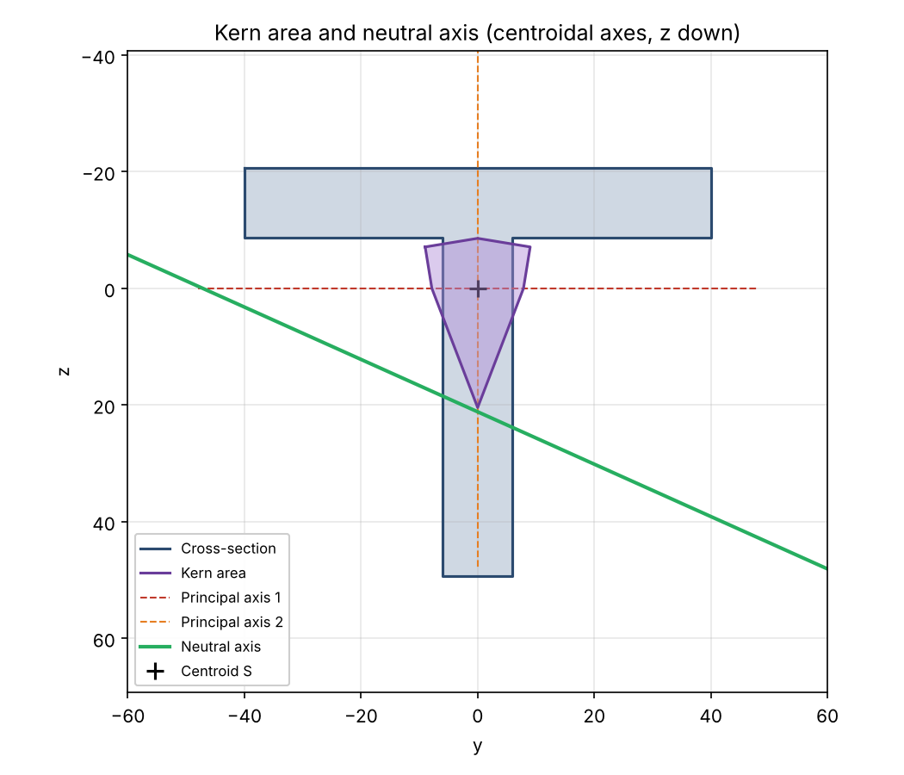

# Structural Mechanics Tools

Python tools for beam cross-sections: section properties, principal axes, kern area and neutral axis. I wrote them while studying elastostatics, to check hand calculations and to understand the methods better by implementing them myself.



## Tools

| File | What it does |
|---|---|
| `kern_area.py` | Area, centroid and second moments of any polygonal section (shoelace formula), principal axes, kern area (via the convex hull), neutral axis and extreme stresses under N, My, Mz. Plots everything with matplotlib. |
| `composite_section.py` | Interactive calculator for sections built from standard shapes (rectangles, circles, rings, triangles, quarter circles, thin-walled bars), including cut-outs. Prints a full step-by-step solution with the Steiner terms, which doubles as a cross-check of the result. |
| `axis_transformation.py` | Rotates Iy, Iz, Iyz and the bending moments My, Mz by an angle, and finds the principal moments and principal angle. |
| `calculator/` | The same tools ported to the TI-Nspire CX II (MicroPython, `ti_plotlib` instead of matplotlib). |

## Usage

```bash
pip install -r requirements.txt

python kern_area.py                    # T-section example, opens the plot
python kern_area.py --save plot.png    # save the plot instead
python composite_section.py            # interactive (prompts in German)
python axis_transformation.py          # interactive
```

To analyse your own section, call `analyse()` from `kern_area.py`:

```python
from kern_area import analyse

points = [(-40, 0), (40, 0), (40, 12), (6, 12), (6, 70), (-6, 70), (-6, 12), (-40, 12)]  # mm
analyse(points, n=-60e3, my=1.2e6, mz=0.4e6)  # N, Nmm
```

Output for the T-section above (shortened):

```
A   = 1656
yS  = 0   zS = 20.7101   (in input coordinates)
Iy  = 700893
Iz  = 520352
I1  = 700893   I2 = 520352   phi* = 0 deg

=== Kern area (centroidal) ===
K1 = (-9.005, -7.11)   K2 = (0, -8.587)   K3 = (9.005, -7.11)
K4 = (7.856, 0)        K5 = (0, 20.44)    K6 = (-7.856, 0)

sigma_max = 52.77   sigma_min = -102.4
```

## Conventions

- y to the right, **z downwards**, x along the beam axis
- Iy = ∫z² dA, Iz = ∫y² dA, **Iyz = −∫yz dA**
- Bending stress: σ = N/A + (My/Iy)·z − (Mz/Iz)·y, valid for principal axes (Iyz = 0)
- The kern area and neutral axis assume y and z are principal axes; the scripts warn if Iyz ≠ 0

## Verification

The results were checked against textbook cases:

- Rectangle b × h: kern is a rhombus with half-diagonals b/6 and h/6
- A rectangle rotated by 30°: `kern_area.py` (computed from the polygon) and `axis_transformation.py` (rotated with the transformation formulas) give identical Iy, Iz, Iyz and principal angle
- Right triangle: Iyz matches the closed-form value ±b²h²/72
